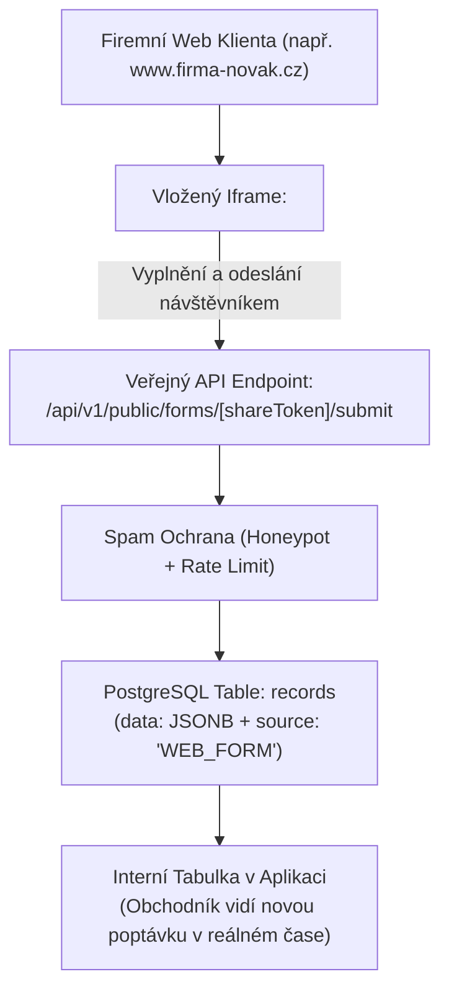

# Detailní Technická Specifikace a Architektura: Foxly - Chytré Tabulky (foxly.cz)

Tento dokument představuje ucelenou a detailní technickou specifikaci platformy pro tvorbu podnikových aplikací bez nutnosti programování. Systém je navržen jako **B2B Multi-Tenant SaaS platforma**, kde má každá firma neprostupně oddělené prostředí, možnost provozu na **vlastní doméně (Custom Domain / Subdoméně)**, správu zaměstnanců, import z Excelu, analytické dashboardy a **veřejné webové formuláře pro integraci přes iframe (sběr dat z webu přímo do tabulky)**.

---

## 1. Architektonické Principy a Koncepty

Systém je postaven na hierarchické vícevrstvé struktuře s přísnou tenantní izolací, podporou vlastních domén a externích integrací:

```
Centrální Systém (B2B SaaS Multi-Tenant Platforma)
 ├── Přístup přes subdoménu: firma-alfa.vaseplatforma.cz
 ├── Přístup přes vlastní doménu: app.firma-alfa.cz (CNAME + Auto SSL)
 ├── Veřejné formuláře na webu: <iframe src="https://.../share/form/xyz">
 └── Tenant / Workspace (Firma "Alfa s.r.o.")
      ├── Zaměstnanci & Role (Pozvánky, ruční založení účtů, granularita práv)
      ├── Aplikace 1: "Skladové hospodářství"
      │    ├── Tabulky ("Zboží", "Skladové pohyby", "Dodavatelé")
      │    └── Dashboardy (Stav skladu, Obrat)
      ├── Aplikace 2: "Webové Poptávky & CRM"
      │    ├── Tabulka "Poptávky z webu"
      │    │    ├── Pohled 1: Klasická tabulka (Grid) pro obchodníky
      │    │    └── Pohled 2: Veřejný formulář (Iframe na webové stránky)
      │    └── Automatizace: E-mailová notifikace při příchodu nové poptávky
      └── Aplikace 3: "HR & Zaměstnanci" (Import z XLSX, tisk smluv)
```

### Základní pilíře:
1. **Veřejné Webové Formuláře (Iframe / Embed do webu):**
   - Ke kterékoliv tabulce (např. *Poptávky, Dotazník spokojenosti, Registrace na školení*) lze vygenerovat samostatný formulářový pohled.
   - Uživatel získá připravený kód `<iframe>`, který vloží na svůj WordPress, Webflow, Shoptet nebo vlastní web.
   - Záznamy z webu padají okamžitě v reálném čase do interní tabulky.
2. **Podpora Vlastních Domén a Subdomén (White-Labeling):**
   - Klient může systém provozovat na své doméně (např. `system.firma-novak.cz`) s automatickým vystavením HTTPS certifikátů přes Caddy On-Demand TLS.
3. **100% Tenant Izolace (Multi-tenancy):**
   - Neprostupnost dat mezi jednotlivými firmami vynucená na úrovni routingu, middleware i databáze.
4. **Správa zaměstnanců & Granulární práva:**
   - Vytvoření účtů, pozvánky e-mailem a práva k vybraným aplikacím a tabulkám.
5. **Inteligentní Import z Excelu (.xlsx / .csv):**
   - Vytvoření nové tabulky nahráním souboru nebo doplnění dat do existující tabulky.
6. **Zero-DDL architektura & Rychlé Agregace v PostgreSQL 16:**
   - Data v `JSONB` s GIN indexy, bleskové součty (`SUM`), průměry (`AVG`) a KPI grafy pro manažerské dashboardy.

---

## 2. Modul Veřejných Formulářů a Iframe Integrace (Web Forms)

Tato funkce funguje jako moderní veřejné formuláře pro sběr dat přímo do tabulky:



### 1. Konfigurace Formuláře v Administraci:
Administrátor si v tabulce přidá pohled typu `FORM` a v editoru nastaví:
* **Název formuláře a podnadpis:** (např. *"Nezávazná poptávka služeb"*).
* **Výběr zobrazených polí:** Které sloupce tabulky má formulář obsahovat a v jakém pořadí (např. Jméno, E-mail, Telefon, Text poptávky, Soubor/Příloha).
* **Vlastní popisky a nápovědy:** Možnost přepsat název sloupce pro veřejnost (např. sloupec `fld_name` zobrazit jako *"Vaše celé jméno"*).
* **Skrytá výchozí pole (Hidden defaults):** Automaticky nastavit skrytou hodnotu (např. pole `Stav` = *"Nová poptávka z webu"*).
* **Děkovná zpráva nebo přesměrování:**
  * Zobrazení textu: *"Děkujeme za poptávku, ozveme se vám do 24 hodin."*
  * Nebo přesměrování na děkovací stránku (Redirect URL): `https://www.firma-novak.cz/dekujeme`.
* **Design a barvy:** Možnost nastavit barvu tlačítek a vložit logo firmy.

### 2. Kód pro vložení na web (Iframe kód na 1 kliknutí):
V rozhraní se vygeneruje snippet připravený ke zkopírování:
```html
<iframe 
  src="https://app.vasedomena.cz/share/form/frm_8a9f2bc" 
  width="100%" 
  height="650" 
  frameborder="0" 
  style="border: none; border-radius: 8px; box-shadow: 0 4px 12px rgba(0,0,0,0.08);"
  allow="camera; microphone; autoplay; encrypted-media">
</iframe>
```

### 3. Zabezpečení proti spamu:
* **Honeypot pole:** Neviditelné skryté pole pro roboty. Pokud ho bot vyplní, formulář se tiše zahodí.
* **Rate Limiting:** Omezení počtu odeslání z jedné IP adresy (ochrana proti zahlcení).
* **Podpora Cloudflare Turnstile / hCaptcha:** Volitelná neinvazivní captcha pro rizikové formuláře.
* **CORS a CSP hlavičky:** Server povolí vložení formuláře v iframe na libovolný web zákazníka (`frame-ancestors *`).

---

## 3. Kompletní Databázové Schéma (Prisma / PostgreSQL)

Schéma nyní obsahuje podporu pro **veřejné formuláře, sdílecí tokeny a ochranu**:

```prisma
datasource db {
  provider   = "postgresql"
  url        = env("DATABASE_URL")
}

generator client {
  provider = "prisma-client-js"
}

// -------------------------------------------------------------
// 1. UŽIVATELÉ, WORKSPACE (FIRMY) A DOMÉNY
// -------------------------------------------------------------

enum WorkspaceRole {
  OWNER
  ADMIN
  MEMBER
}

enum TablePermissionLevel {
  FULL_ACCESS
  READ_WRITE
  READ_ONLY
  OWN_RECORDS
  NO_ACCESS
}

model User {
  id             String            @id @default(uuid())
  email          String            @unique
  passwordHash   String
  name           String
  avatarUrl      String?
  isSystemAdmin  Boolean           @default(false)
  createdAt      DateTime          @default(now())
  updatedAt      DateTime          @updatedAt
  memberships    WorkspaceMember[]
  createdRecords Record[]          @relation("RecordCreator")
  auditLogs      AuditLog[]
  invitations    WorkspaceInvitation[]
}

model Workspace {
  id             String                @id @default(uuid())
  name           String                // Název firmy (např. "Autodoprava Novák s.r.o.")
  slug           String                @unique
  subdomain      String?               @unique
  customDomain   String?               @unique
  domainVerified Boolean               @default(false)
  logoUrl        String?
  primaryColor   String?               @default("#3b82f6")
  createdAt      DateTime              @default(now())
  updatedAt      DateTime              @updatedAt
  members        WorkspaceMember[]
  invitations    WorkspaceInvitation[]
  apps           App[]
  apiKeys        ApiKey[]
}

model WorkspaceMember {
  id               String               @id @default(uuid())
  workspaceId      String
  userId           String
  role             WorkspaceRole        @default(MEMBER)
  jobTitle         String?
  allowedAppIds    String[]
  createdAt        DateTime             @default(now())
  workspace        Workspace            @relation(fields: [workspaceId], references: [id], onDelete: Cascade)
  user             User                 @relation(fields: [userId], references: [id], onDelete: Cascade)
  tablePermissions MemberTablePermission[]

  @@unique([workspaceId, userId])
}

model MemberTablePermission {
  id              String               @id @default(uuid())
  memberId        String
  tableId         String
  permissionLevel TablePermissionLevel @default(FULL_ACCESS)
  member          WorkspaceMember      @relation(fields: [memberId], references: [id], onDelete: Cascade)
  table           Table                @relation(fields: [tableId], references: [id], onDelete: Cascade)

  @@unique([memberId, tableId])
}

model WorkspaceInvitation {
  id          String        @id @default(uuid())
  workspaceId String
  email       String
  role        WorkspaceRole @default(MEMBER)
  token       String        @unique
  invitedById String
  expiresAt   DateTime
  createdAt   DateTime      @default(now())
  workspace   Workspace     @relation(fields: [workspaceId], references: [id], onDelete: Cascade)
  invitedBy   User          @relation(fields: [invitedById], references: [id], onDelete: Cascade)
}

model ApiKey {
  id          String    @id @default(uuid())
  workspaceId String
  name        String
  keyHash     String    @unique
  permissions Json
  createdAt   DateTime  @default(now())
  expiresAt   DateTime?
  workspace   Workspace @relation(fields: [workspaceId], references: [id], onDelete: Cascade)
}

// -------------------------------------------------------------
// 2. APLIKACE, TABULKY A METADATA
// -------------------------------------------------------------

model App {
  id          String       @id @default(uuid())
  workspaceId String
  name        String
  description String?
  icon        String       @default("Folder")
  color       String       @default("#3b82f6")
  sortOrder   Int          @default(0)
  createdAt   DateTime     @default(now())
  updatedAt   DateTime     @updatedAt
  workspace   Workspace    @relation(fields: [workspaceId], references: [id], onDelete: Cascade)
  tables      Table[]
  dashboards  Dashboard[]
}

model Table {
  id               String                 @id @default(uuid())
  appId            String
  name             String
  singularName     String
  icon             String                 @default("Table")
  sortOrder        Int                    @default(0)
  createdAt        DateTime               @default(now())
  updatedAt        DateTime               @updatedAt
  app              App                    @relation(fields: [appId], references: [id], onDelete: Cascade)
  columns          Column[]
  records          Record[]
  views            View[]
  automations      Automation[]
  widgets          Widget[]
  memberPermissions MemberTablePermission[]
}

enum ColumnType {
  TEXT
  LONG_TEXT
  NUMBER
  CURRENCY
  DATE
  DATETIME
  SELECT
  MULTI_SELECT
  CHECKBOX
  RELATION
  LOOKUP
  ROLLUP
  FILE
  FORMULA
  AUTO_NUMBER
  USER
}

model Column {
  id          String     @id @default(uuid())
  tableId     String
  key         String
  label       String
  type        ColumnType
  description String?
  isPrimary   Boolean    @default(false)
  isRequired  Boolean    @default(false)
  isUnique    Boolean    @default(false)
  defaultValue Json?
  config      Json       @default("{}")
  sortOrder   Int        @default(0)
  createdAt   DateTime   @default(now())
  updatedAt   DateTime   @updatedAt
  table       Table      @relation(fields: [tableId], references: [id], onDelete: Cascade)

  @@unique([tableId, key])
}

// -------------------------------------------------------------
// 3. POHLEDY, FORMULÁŘE (IFRAME) A DASHBOARDY
// -------------------------------------------------------------

enum ViewType {
  GRID
  FORM          // Veřejný nebo interní formulář (Iframe)
  KANBAN
  CALENDAR
  PRINT
}

model View {
  id          String    @id @default(uuid())
  tableId     String
  name        String    // "Poptávkový formulář na web"
  type        ViewType  @default(GRID)
  isDefault   Boolean   @default(false)
  isPublic    Boolean   @default(false) // Zda je formulář přístupný veřejnosti přes iframe
  shareToken  String?   @unique         // Unikátní náhodný identifikátor pro URL (např. frm_8a9f2bc)
  sortOrder   Int       @default(0)
  config      Json      // Nastavení polí, nápověd, děkovné zprávy, skrytých hodnot a stylů
  createdAt   DateTime  @default(now())
  updatedAt   DateTime  @updatedAt
  table       Table     @relation(fields: [tableId], references: [id], onDelete: Cascade)
}

model Dashboard {
  id          String    @id @default(uuid())
  appId       String
  name        String
  description String?
  icon        String    @default("LayoutDashboard")
  sortOrder   Int       @default(0)
  layout      Json      @default("[]")
  createdAt   DateTime  @default(now())
  updatedAt   DateTime  @updatedAt
  app         App       @relation(fields: [appId], references: [id], onDelete: Cascade)
  widgets     Widget[]
}

enum WidgetType {
  KPI_METRIC
  BAR_CHART
  LINE_CHART
  PIE_CHART
  SUMMARY_TABLE
}

enum AggregationFunction {
  COUNT
  SUM
  AVG
  MIN
  MAX
}

model Widget {
  id          String              @id @default(uuid())
  dashboardId String
  tableId     String
  title       String
  type        WidgetType
  targetField String?
  aggregation AggregationFunction @default(COUNT)
  groupField  String?
  dateGrouping String?
  filterRules Json                @default("[]")
  config      Json                @default("{}")
  sortOrder   Int                 @default(0)
  createdAt   DateTime            @default(now())
  updatedAt   DateTime            @updatedAt
  dashboard   Dashboard           @relation(fields: [dashboardId], references: [id], onDelete: Cascade)
  table       Table               @relation(fields: [tableId], references: [id], onDelete: Cascade)
}

// -------------------------------------------------------------
// 4. ZÁZNAMY, AUDIT A AUTOMATIZACE
// -------------------------------------------------------------

model Record {
  id          String     @id @default(uuid())
  tableId     String
  data        Json       // Dynamická data řádku
  source      String     @default("INTERNAL") // "INTERNAL", "WEB_FORM", "EXCEL_IMPORT", "API"
  createdById String?
  createdAt   DateTime   @default(now())
  updatedAt   DateTime   @updatedAt
  table       Table      @relation(fields: [tableId], references: [id], onDelete: Cascade)
  createdBy   User?      @relation("RecordCreator", fields: [createdById], references: [id], onDelete: SetNull)
  auditLogs   AuditLog[]

  @@index([tableId])
}

model AuditLog {
  id          String   @id @default(uuid())
  recordId    String
  userId      String?
  action      String   // "CREATE", "UPDATE", "DELETE", "IMPORT", "WEB_SUBMIT"
  changes     Json
  timestamp   DateTime @default(now())
  record      Record   @relation(fields: [recordId], references: [id], onDelete: Cascade)
  user        User?    @relation(fields: [userId], references: [id], onDelete: SetNull)

  @@index([recordId])
}

model Automation {
  id            String   @id @default(uuid())
  tableId       String
  name          String
  triggerType   String   // např. "ON_FORM_SUBMIT"
  triggerConfig Json
  actionType    String   // např. "SEND_EMAIL_NOTIFICATION"
  actionConfig  Json
  isActive      Boolean  @default(true)
  table         Table    @relation(fields: [tableId], references: [id], onDelete: Cascade)
}
```

---

## 4. Kompletní Plán Realizace (Roadmap)

Projekt je rozdělen do 7 ucelených kroků:

1. **Fáze 1: Docker & Multi-Tenant Jádro s Routováním Domén**
   * Next.js 15, PostgreSQL 16, MinIO storage.
   * Middleware pro podporu subdomén a vlastních domén (`app.firma-novak.cz`).
   * Registrace firmy, nastavení subdomény a profilu administrátora.
2. **Fáze 2: Správa Zaměstnanců & Granulární Oprávnění**
   * Vytváření zaměstnaneckých účtů administrátorem a pozvánky e-mailem.
   * Oprávnění k vybraným aplikacím a tabulkám.
3. **Fáze 3: Aplikace & Vizuální Schema Builder**
   * Vytváření aplikací a tabulek.
   * Vizuální konfigurátor sloupců (Text, Číslo, Měna, Datum, Výběr s barvami, Checkbox, Relace, Uživatel).
4. **Fáze 4: Import z Excelu (.xlsx) & CSV**
   * Vytvoření nové tabulky z Excelu s automatickou detekcí typů sloupců.
   * Hromadný import dat do existující tabulky s vizuálním párováním.
5. **Fáze 5: Data Grid s inline editací, filtry & patičkové součty (SUM, AVG)**
   * TanStack Table v8 s virtualizací pro desítky tisíc řádků.
   * Inline editace v buňce, formulář detailu řádku.
   * Součty a průměry v patičce reagující na vyfiltrovaná data.
6. **Fáze 6: Veřejné Webové Formuláře (Iframe / Embed do webu)**
   * Tvorba formulářového pohledu nad tabulkou.
   * Výběr polí, vlastní nápovědy, skrytá výchozí pole, děkovná zpráva / přesměrování.
   * Veřejná URL a generátor kódu `<iframe>` pro vložení na web.
   * Ochrana proti spamu (Honeypot + Rate Limit) a okamžité uložení do tabulky.
7. **Fáze 7: Analytické Dashboardy, Tiskové Sestavy & Produkční SSL**
   * Manažerské nástěnky s KPI kartami a grafy (`Recharts`).
   * Tisk čistých A4 protokolů a smluv (`@media print`).
   * Automatické SSL certifikáty (Caddy On-Demand TLS) pro vlastní domény klientů.
